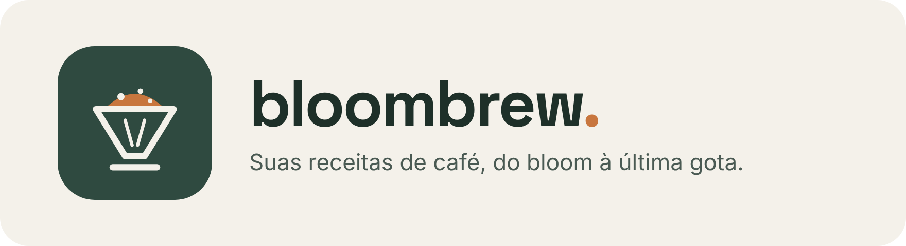
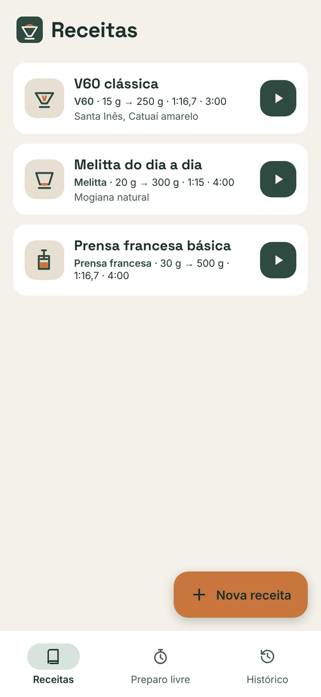
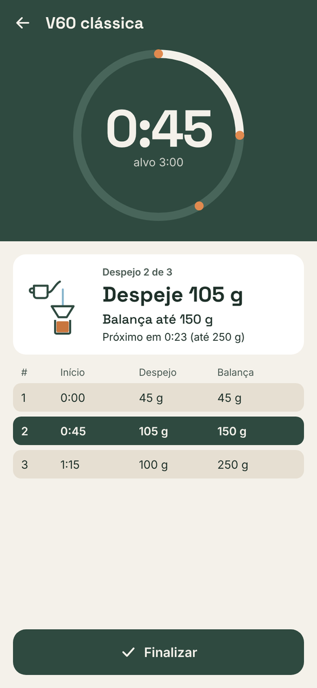
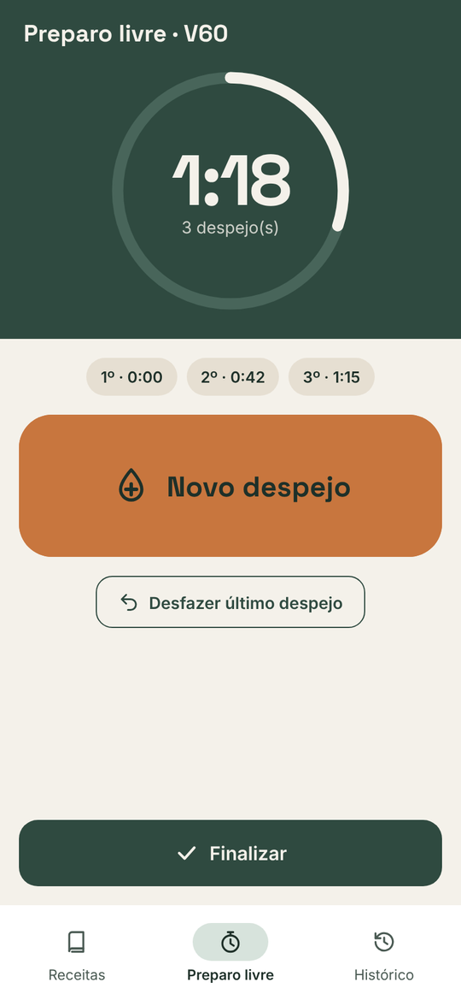
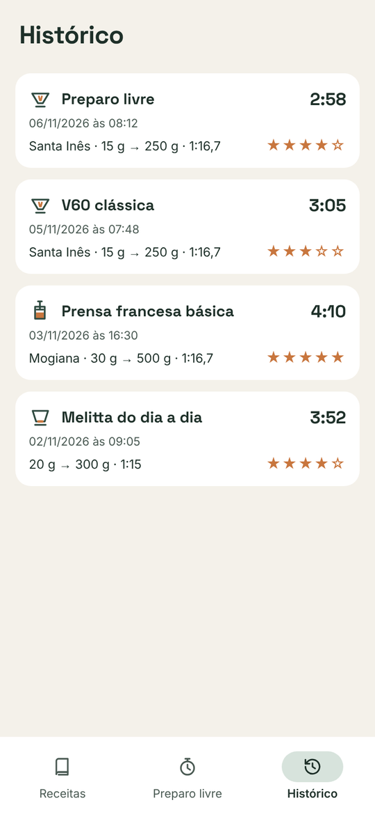

<p align="center">
  
</p>

<p align="center">
  <b>O caderno de receitas de café que cabe no bolso.</b><br>
  Para V60, Melitta e prensa francesa. Gratuito, sem conta e funciona sem internet.
</p>

<p align="center">
  <a href="https://github.com/HeitorAnglada/coffee-app/releases/latest/download/Bloombrew.apk">
    
  </a>
</p>

<p align="center">
  
  
  
  
</p>

---

## ☕ O que dá para fazer

**📖 Guardar suas receitas**
Anote o café, o moedor, a moagem, a dose, quanto de água em cada despejo e o tempo. O app já vem com três receitas para você começar.

**⏱️ Preparar com o app te guiando**
Abra uma receita e toque em *Preparar*. O timer avisa a hora de cada despejo, quanto despejar e até quanto a balança deve chegar. O celular vibra quando chega a hora do próximo despejo.

**💧 Preparar do seu jeito (preparo livre)**
Toque em *Iniciar preparo* junto com o primeiro despejo e em *Novo despejo* a cada despejo seguinte. No final, é só dizer quantos gramas teve cada um. Se ficou bom, salve como receita.

**⭐ Lembrar de cada xícara**
Todo preparo vai para o histórico com nota em estrelas, proporção, tempo e moagem. Gostou de um? Repita ou transforme em receita.

**🌱 Simples para quem está começando**
As opções avançadas (temperatura, tempo-alvo, notas) ficam guardadas até você precisar delas.

**🔒 Seus dados são seus**
Nada sai do seu celular. Não precisa criar conta nem estar conectado à internet.

---

## 📲 Como instalar

1. No celular Android, toque em **[Baixar Bloombrew.apk](https://github.com/HeitorAnglada/coffee-app/releases/latest/download/Bloombrew.apk)**.
2. Abra o arquivo baixado (fica nas notificações ou na pasta *Downloads*).
3. Se o Android perguntar, permita instalar apps desta fonte e toque em **Instalar**.

Funciona no Android 8.0 ou mais novo. Para atualizar, baixe e instale de novo pelo mesmo link: suas receitas e seu histórico continuam lá.

> O Android avisa sobre "app desconhecido" porque o Bloombrew ainda não está na Play Store. É normal.

---

<details>
<summary><b>Para desenvolvedores</b></summary>

### Rodar pelo código

- **Android Studio** (Ladybug ou mais novo): *File → Open* na pasta do repositório, espere o Gradle sincronizar e clique em **Run ▶**.
- **Linha de comando** (JDK 17 e Android SDK com `ANDROID_HOME`):

  ```bash
  ./gradlew testDebugUnitTest   # testes
  ./gradlew assembleDebug       # gera app/build/outputs/apk/debug/app-debug.apk
  ./gradlew installDebug        # instala no celular conectado
  ```

A cada push no `master`, o GitHub Actions roda os testes, gera o APK e publica uma nova versão em [Releases](https://github.com/HeitorAnglada/coffee-app/releases); o link de download acima sempre aponta para a mais nova. O APK é assinado com a chave de debug fixa em `app/debug.keystore`, para que uma versão instale por cima da outra.

### Tecnologia

Kotlin, Jetpack Compose (Material 3), Room (SQLite local), Navigation Compose e ViewModel + StateFlow. minSdk 26 (Android 8.0), targetSdk 35.

```
app/src/main/java/com/heitoranglada/coffeeapp/
├── domain/   # regras puras: métodos, despejos, formatação, passos do preparo guiado
├── data/     # Room: entidades, DAOs, banco e repositório (+ receitas-modelo)
└── ui/
    ├── recipes/    # lista, detalhe e cadastro de receitas
    ├── brew/       # timer: preparo guiado e preparo livre
    ├── history/    # histórico de preparos
    └── components/ # formulário, ícones, animações e componentes compartilhados
```

### Identidade visual

- Logo: coador V60 em traço com a "cúpula" do bloom (`res/drawable/ic_launcher_foreground.xml`).
- Cores: verde coador `#2F4A40`, terracota `#C8763E`, papel `#F4F1EA`, areia `#E6DFD2`.
- Fontes: Space Grotesk (títulos e timer) e Inter (textos), embutidas em `res/font` (SIL Open Font License).
- Ícones próprios em `res/drawable/ic_bb_*.xml` e animações em `ui/components/Animations.kt`. As animações ficam paradas quando o Android está com as animações desligadas.
- As imagens deste README estão em `docs/images` e mostram as telas do design aprovado.

</details>
